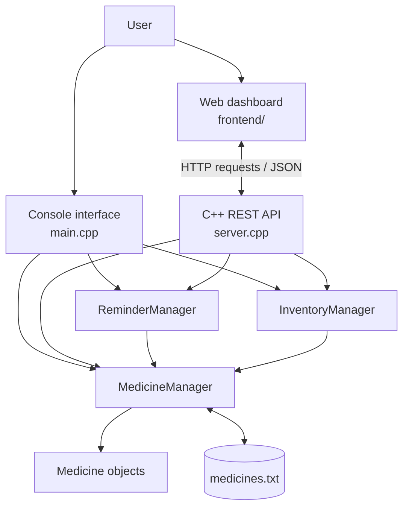

# Med_Reminder — Medicine Reminder & Inventory Management System

**A C++-powered medicine management application with a REST API and a responsive web dashboard.**

Med_Reminder helps individuals and households organise medicine records, monitor available stock, track expiry dates, and review scheduled doses. The repository combines a native C++ application layer with a browser-based dashboard.

> **Academic and safety note:** Med_Reminder is an organisational aid only. It does not provide medical advice, prescribe medicines, or determine dosage. Users must follow instructions from a qualified healthcare professional and verify all medicine details.

---

## Project at a glance

| Item | Details |
|---|---|
| Project | Med_Reminder — Medicine Reminder & Inventory Management System |
| Primary language | C++ (C++17 for the REST-server build) |
| Application interfaces | Console application and web dashboard |
| Backend | Native C++ HTTP server and REST API |
| Frontend | HTML, CSS, and JavaScript |
| Data persistence | Local pipe-delimited `medicines.txt` file |
| HTTP library | `cpp-httplib` |
| JSON library | `nlohmann/json` |
| Dashboard charts | Chart.js |
| Container support | Docker |
| Deployment configuration | Render (`render.yaml`) |

## 1. Problem statement

Medicine information is often maintained manually. This can make it difficult to remember scheduled doses, know how much stock is available, and notice medicines that are expired or nearing expiry. Med_Reminder provides a central application for keeping these records and displaying relevant reminders and inventory alerts.

## 2. Main features

### Medicine records

- Register a medicine with an automatically generated ID.
- Store its name, quantity, expiry date, dosage instructions, reminder times, notes, and low-stock threshold.
- View all records and search by medicine ID or name.
- Update or delete existing records.

### Dose reminders

- Store one or more daily reminder times in 24-hour `HH:MM` format.
- View a chronological daily dose schedule.
- Compare scheduled times with the system clock and return alerts when a dose is due.
- Suppress repeated alerts for the same medicine, date, and scheduled time during the running server/application session.
- Simulate a reminder time from the console menu for demonstration and manual checking.

### Inventory management

- View stock quantities and stock status.
- Add purchased stock and record consumed quantities.
- Configure a low-stock threshold for each medicine.
- Identify low-stock and out-of-stock medicines.

### Expiry monitoring

- Calculate the number of calendar days remaining until the stored expiry date.
- Display expiry reports and filter expired or near-expiry records.
- Expose expiry status through the REST API for the dashboard.

### Web dashboard

- Provides browser-based views for dashboard information, medicine records, schedules, and inventory/expiry information.
- Communicates with the C++ backend using HTTP requests and JSON.
- Polls the reminder-check endpoint every 10 seconds while the dashboard is open.
- Includes Chart.js-based visualisations and browser-side sound/modal reminder behaviour.

---

## 3. What C++ does vs. what OOP does in this project

This distinction is important: **C++ is the programming language used to implement the system; OOP is the design approach used to organise the C++ code.** They work together, but they are not the same thing.

| **Role of C++** — implementation language | **Role of OOP** — design approach |
|---|---|
| Implements the console application in `main.cpp`. | Divides the application into classes with clear responsibilities. |
| Implements the HTTP server and REST routes in `server.cpp`. | Models a medicine as a `Medicine` object with its own data and methods. |
| Uses `std::string` for medicine names, IDs, dates, and dosage instructions. | Uses encapsulation: medicine fields are private and accessed through public methods. |
| Uses `std::vector<Medicine>` to store the in-memory collection of medicine objects. | Uses composition: `MedicineManager` contains and manages a collection of `Medicine` objects. |
| Uses `std::set` to track alert keys and prevent duplicate reminders. | Uses association: `ReminderManager` and `InventoryManager` hold references to the same `MedicineManager`. |
| Uses `<fstream>` (`ifstream`/`ofstream`) to load and save `medicines.txt`. | Uses abstraction and separation of responsibilities so each manager exposes operations without making other modules duplicate its internal logic. |
| Uses `<ctime>`, `<sstream>`, `<iomanip>`, and other standard-library facilities for time, parsing, and formatting. | Uses constructors, public interfaces, and class methods to initialise and work with related data and behaviour. |
| Uses `cpp-httplib` and `nlohmann/json` from C++ to receive HTTP requests and exchange JSON with the frontend. | Reuses the same manager classes from both the console interface and the REST API instead of implementing the business rules twice. |

### Where these ideas appear in the code

| File / class | C++ responsibility | OOP responsibility |
|---|---|---|
| `main.cpp` | Program entry point, menu loop, input routing, and manager construction. | Creates objects and coordinates their public methods. |
| `Medicine.h` / `Medicine.cpp` | Defines and implements the medicine data type. | Encapsulation through private data members, public getters/setters, and constructors. |
| `MedicineManager.h` / `MedicineManager.cpp` | Medicine registration, display, search, update, delete, ID generation, validation, and file operations. | Owns a `vector<Medicine>` and acts as the central manager for medicine records. |
| `ReminderManager.h` / `ReminderManager.cpp` | Reads system date/time, prepares schedules, checks due reminders, and creates alert keys. | Holds a `MedicineManager&` so it uses the central medicine collection without maintaining a second copy. |
| `InventoryManager.h` / `InventoryManager.cpp` | Restocks and reduces stock, checks thresholds, and calculates expiry status. | Holds a `MedicineManager&` and keeps inventory/expiry responsibilities separate from reminder logic. |
| `server.cpp` | Implements HTTP routes, parses JSON, serialises responses, adds CORS headers, and serves static frontend files. | Uses the existing manager objects and their methods rather than duplicating medicine-management rules. |

### OOP concepts demonstrated

1. **Classes and objects:** `Medicine`, `MedicineManager`, `ReminderManager`, and `InventoryManager` represent the system's data and responsibilities.
2. **Encapsulation:** The fields in `Medicine` are private. Public getters and setters provide controlled access.
3. **Constructors:** Constructors initialise `Medicine` objects and connect the reminder/inventory managers to a `MedicineManager` instance.
4. **Composition:** `MedicineManager` contains a `std::vector<Medicine>` that stores the medicine records.
5. **Association:** `ReminderManager` and `InventoryManager` store a reference to `MedicineManager`, so the modules operate on the same central collection.
6. **Abstraction and separation of concerns:** Each manager provides operations for its area—records, reminders, or inventory—while the console and API call those operations through public methods.

> **Accuracy note:** The current class design demonstrates composition and association. It does not rely on inheritance or runtime polymorphism; those are not required to demonstrate OOP in this project.

---

## 4. System architecture



The console application and the REST API are two interfaces to the same C++ manager classes. The browser dashboard sends HTTP requests to `server.cpp`; the server calls the manager classes and returns JSON responses. `MedicineManager` loads and saves the medicine records using the local text file.

---

## 5. Repository structure

```text
Med_Reminder/
├── frontend/
│   ├── index.html          # Dashboard page and interface structure
│   ├── style.css           # Dashboard styling and responsive layout
│   └── app.js              # Browser behaviour and REST API client
├── lib/
│   ├── httplib.h           # cpp-httplib HTTP server library
│   └── json.hpp            # nlohmann/json library
├── main.cpp                # Console application entry point
├── server.cpp              # C++ REST API and static-file server
├── Medicine.h
├── Medicine.cpp            # Medicine data model
├── MedicineManager.h
├── MedicineManager.cpp     # CRUD operations and file persistence
├── ReminderManager.h
├── ReminderManager.cpp     # Dose scheduling and reminder checks
├── InventoryManager.h
├── InventoryManager.cpp    # Stock and expiry management
├── Dockerfile              # Container build for the C++ web server
├── render.yaml             # Render service configuration
├── .dockerignore
├── .gitignore
└── README.md
```

The `medicines.txt` data file is used at runtime and may be created only after the application saves its first records. It is not required to be present in a fresh clone.

---

## 6. Console menu

The console application (`main.cpp`) provides this menu:

| Option | Operation | Purpose |
|---:|---|---|
| 1 | Register New Medicine | Add a medicine record. |
| 2 | View All Medicines | Display saved medicine records. |
| 3 | Search Medicine | Search by medicine ID or name. |
| 4 | Update Medicine | Edit an existing record. |
| 5 | Delete Medicine | Remove a record after confirmation. |
| 6 | Dose Reminder | Check reminders, view the daily schedule, or simulate a time. |
| 7 | Inventory Management | View stock, restock, record usage, and update thresholds. |
| 8 | Expiry Monitoring | View expiry status, expired medicines, and near-expiry medicines. |
| 9 | Save Records | Save records to `medicines.txt`. |
| 10 | Exit | Save records and close the application. |

---

## 7. REST API reference

The native C++ server in `server.cpp` defines the following routes:

| Method | Endpoint | Description |
|---|---|---|
| `GET` | `/api/health` | Server health and current medicine count. |
| `GET` | `/api/medicines` | Retrieve all medicine records. |
| `POST` | `/api/medicines` | Create a medicine record. |
| `GET` | `/api/medicines/{id}` | Retrieve one medicine by ID. |
| `PUT` | `/api/medicines/{id}` | Update a medicine field. |
| `DELETE` | `/api/medicines/{id}` | Delete a medicine by ID. |
| `GET` | `/api/inventory/status` | Retrieve medicine stock information and summary. |
| `GET` | `/api/inventory/alerts` | Retrieve low-stock medicines. |
| `POST` | `/api/inventory/restock` | Add stock to a medicine. |
| `POST` | `/api/inventory/consume` | Deduct used stock. |
| `PUT` | `/api/inventory/threshold` | Update a medicine's low-stock threshold. |
| `GET` | `/api/reminders/schedule` | Retrieve the sorted daily dose schedule. |
| `GET` | `/api/reminders/check` | Retrieve due reminders for the current minute. |
| `GET` | `/api/expiry/report` | Retrieve expiry information for all medicines. |
| `GET` | `/api/expiry/expired` | Retrieve medicines selected by the expired-medicine API filter. |
| `GET` | `/api/expiry/near-expiry` | Retrieve medicines within the 30-day near-expiry API filter. |

The API exchanges JSON. For example, the `POST /api/medicines` route accepts fields such as `name`, `quantity`, `expiryDate`, `dosage`, `reminderTimes`, `notes`, and `lowStockThreshold`.

### API behaviour details worth knowing

- The frontend uses the same origin as the dashboard (`window.location.origin`) as its API base.
- The browser app polls `/api/reminders/check` every 10 seconds while the page is open.
- Reminder de-duplication is held in memory by the running `ReminderManager`; it is not a persistent notification history.
- The server's JSON status calculation uses `EXPIRED` for dates before today, `CRITICAL` for dates up to 7 days away, `NEAR_EXPIRY` for dates up to 30 days away, and `SAFE` beyond that.
- **Expiry boundary detail:** The console's expired list checks for a negative day difference, while `apiGetExpiredMedicines()` currently includes a day difference of zero as well. This means a medicine whose expiry date is today can be classified differently by the console filter and the expired API filter; align these rules if consistent behaviour is required.

---

## 8. Data storage

The application stores records locally in `medicines.txt`. The record format is pipe-delimited:

```text
ID|Name|Quantity|ExpiryDate|Dosage|ReminderTimes|Notes|LowStockThreshold
```

Example:

```text
MED001|Paracetamol|50|15/12/2027|1 tablet after meals|08:00,20:00|Store in cool place|5
```

The file-based approach keeps the academic prototype simple and avoids requiring a database server. Because `|` is the field separator, avoid entering that character inside a medicine field unless the parser is updated to escape it. The file is resolved relative to the program's working directory.

---

## 9. Build and run locally

### Requirements

- GCC/MinGW with C++17 support.
- A terminal such as PowerShell, Command Prompt, or a Linux/macOS shell.
- A modern browser for the web dashboard.

### Clone the repository

```powershell
git clone https://github.com/Saurabh-kumar2111/Med_Reminder.git
cd Med_Reminder
```

### Build and run the console application

```powershell
g++ -std=c++17 -Wall -Wextra -O2 -o MedicineSystem.exe main.cpp Medicine.cpp MedicineManager.cpp ReminderManager.cpp InventoryManager.cpp
.\MedicineSystem.exe
```

### Build and run the web server on Windows (MinGW)

```powershell
g++ -std=c++17 -O2 -Wall -Wextra -I. -o MedicineServer.exe server.cpp Medicine.cpp MedicineManager.cpp ReminderManager.cpp InventoryManager.cpp -lpthread -lws2_32
.\MedicineServer.exe
```

Then open `http://localhost:8080/` in your browser.

On Linux, compile the server with the same source files and `-pthread` (and omit the Windows-only `-lws2_32` option):

```bash
g++ -std=c++17 -O2 -Wall -Wextra -I. -o MedicineServer server.cpp Medicine.cpp MedicineManager.cpp ReminderManager.cpp InventoryManager.cpp -pthread
./MedicineServer
```

The server uses port `8080` by default and reads the `PORT` environment variable when one is supplied by the hosting environment.

---

## 10. Docker and Render configuration

The repository includes:

- `Dockerfile`, which uses a GCC build image to compile `server.cpp` and the manager implementation files, then starts the resulting C++ server.
- `render.yaml`, which describes a Docker-based Render web service named `med-reminder-cpp-system`.

The server reads the hosting platform's `PORT` environment variable. The repository configuration alone does not prove that a live deployment is currently available. Also, the application uses a local text file for persistence; durable data across container restarts should not be assumed unless persistent storage or an external database is configured on the hosting platform.

---

## 11. Validation checklist

Use these cases when testing changes or preparing a project demonstration. This is a suggested verification checklist, not a claim that an automated test suite exists in the repository.

- Register a medicine and confirm that it appears in the medicine list.
- Search using a valid ID, an invalid ID, and a medicine name.
- Update a record and confirm the saved values after restarting the program.
- Delete a record and confirm it no longer appears.
- Try negative quantities, non-numeric input at numeric prompts, and stock deduction greater than available stock.
- Set a reminder time and use the console's simulated-time option to test the due-reminder path.
- Confirm that repeated checks do not show the same alert repeatedly during the same reminder interval in one running session.
- Test medicines with expiry dates in the past, today, within 7 days, within 30 days, and beyond 30 days.
- Test the REST health route and the medicine, inventory, reminder, and expiry routes from a browser or API client.

---

## 12. Current scope and limitations

- The current data model is local and file-based; it is not a multi-user database application.
- Console automatic reminder checks occur in the menu loop. The web dashboard checks reminders through periodic browser polling while it is open; neither mode is an independent mobile notification service.
- The reminder de-duplication cache is in memory and resets when the relevant process restarts.
- Date input validation in `MedicineManager` checks the `DD/MM/YYYY` structure and basic numeric ranges; it does not fully validate every calendar combination (for example, all month/day combinations).
- The application does not provide medical guidance or confirm whether a medicine or dosage is clinically appropriate.
- Durable persistence in a cloud container requires storage configuration beyond the local `medicines.txt` file.

## 13. Possible future improvements

- Use SQLite or another database for more robust persistence.
- Add user authentication and separate household profiles.
- Add a persistent dose history and a way to confirm a dose was taken.
- Reconcile expiry-date boundary handling between console and API filters.
- Add automated unit and integration tests for the managers and REST endpoints.
- Add a durable cloud-storage strategy and backups.
- Improve accessibility and provide configurable reminder behaviour.

---

## Author

**Saurabh Kumar**  
B.Tech — Computer Science and Engineering (CSE)  
Vivekananda Institute of Professional Studies (VIPS)

GitHub: [Saurabh-kumar2111](https://github.com/Saurabh-kumar2111)

---

**Med_Reminder — organised medicine records, clearer reminders, and better inventory visibility.**
