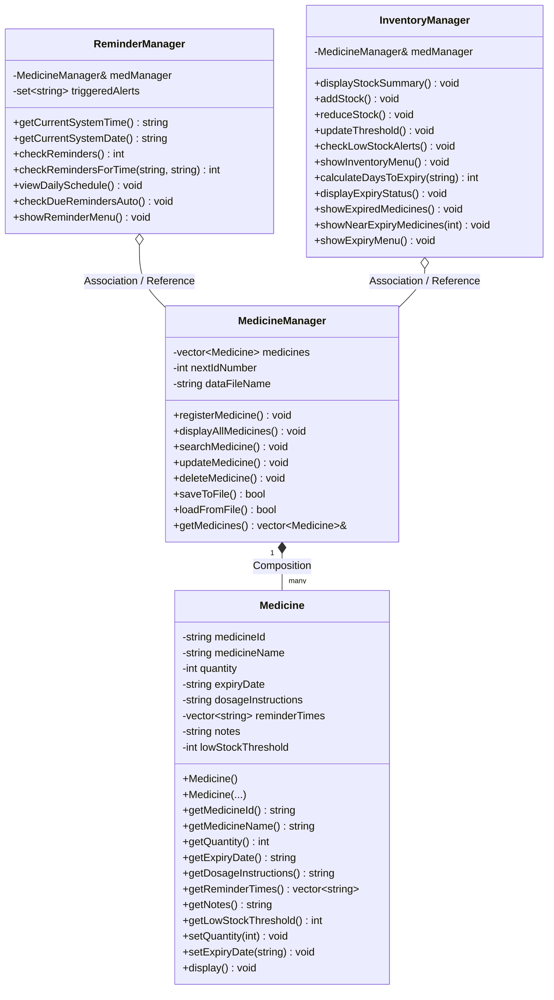

# Medicine Reminder & Inventory Management System

**An Object-Oriented C++ Academic Project for Household Medicine Management**

---

## 1. Project Overview

The **Medicine Reminder & Inventory Management System** is a modular, console-based desktop application developed in modern C++ utilizing Object-Oriented Programming (OOP) principles. It is designed to assist individuals and households in managing their medicine supplies, tracking expiration dates, scheduling dosage intake, and receiving timely alerts.

### Core Capabilities:
- **Medicine Registration & Maintenance**: Record medicine ID, name, quantity, expiry date, dosage instructions, reminder times, and optional notes.
- **Dose Reminder Engine**: Compares the system clock against scheduled dose times and displays notifications while the application is running, with duplicate alert suppression.
- **Inventory Tracking & Restocking**: Track available units, restock newly purchased batches, deduct used quantities, and configure custom minimum stock thresholds.
- **Expiry Monitoring**: Uses calendar date arithmetic to classify medicines into Safe/Valid, Nearing Expiry (within 30 days), and Expired (with critical health warnings).
- **Persistent Local Database**: Automatically saves and loads all records from a structured text database (`medicines.txt`).

---

## 2. Technology Stack & Prerequisites

- **Language**: C++ (C++11 / C++17 standard)
- **Compiler**: GCC / MinGW-W64 (v15+ compatible)
- **Standard Libraries Utilized**:
  - `<iostream>`, `<iomanip>`: Formatted console I/O
  - `<string>`, `<sstream>`: String parsing, ID generation, and formatting
  - `<vector>`: Dynamic storage of medicine objects
  - `<set>`: In-memory cache for reminder alert de-duplication
  - `<fstream>`: File reading (`ifstream`) and writing (`ofstream`)
  - `<ctime>`: Live system clock query and calendar date arithmetic
  - `<limits>`: Stream buffer clearance and input validation
- **Target OS**: Windows / Linux / macOS (Cross-platform standard C++)

---

## 3. Project Architecture & OOP Design

The system adheres to modular software engineering principles, dividing responsibilities among four primary classes:



### Key OOP Principles Demonstrated:
1. **Encapsulation**:
   - `Medicine` private members (`medicineId`, `quantity`, etc.) can only be read or modified through public getters and setters.
   - Setters include internal validation (e.g., rejecting negative quantities).
2. **Composition**:
   - `MedicineManager` "has-a" `vector<Medicine>`, managing the complete lifecycle of medicine records.
3. **Association & Single Source of Truth**:
   - `ReminderManager` and `InventoryManager` receive a reference (`MedicineManager&`) to inspect and update medicines without duplicating data.
4. **Separation of Concerns**:
   - Data storage/CRUD (`MedicineManager`), Time/Scheduling (`ReminderManager`), and Inventory/Expiry (`InventoryManager`) are isolated in their own modules.

---

## 4. File Structure

```
Project-Medicine_Reminder/
├── main.cpp                  # Program entry point, menu loop, and event routing
├── Medicine.h                # Medicine class declaration (header)
├── Medicine.cpp              # Medicine class implementation
├── MedicineManager.h         # MedicineManager declaration (header)
├── MedicineManager.cpp       # CRUD operations, ID generator, file I/O
├── ReminderManager.h         # ReminderManager declaration (header)
├── ReminderManager.cpp       # System clock comparison, timetable, simulation
├── InventoryManager.h        # InventoryManager declaration (header)
├── InventoryManager.cpp      # Restocking, usage deduction, expiry monitoring
├── medicines.txt             # Persistent local text database (auto-created)
└── README.md                 # Project documentation and guide
```

---

## 5. Compilation and Execution Guide

### Using GCC / MinGW (Command Prompt or PowerShell):

1. **Open Terminal** in the project directory:
   ```powershell
   cd "c:\Users\Saurav kumar\OneDrive\Documents\Project-Medicine_Reminder"
   ```

2. **Compile all files with optimization and warning flags**:
   ```powershell
   g++ -Wall -Wextra -O2 -o MedicineSystem.exe main.cpp Medicine.cpp MedicineManager.cpp ReminderManager.cpp InventoryManager.cpp
   ```

3. **Run the executable**:
   ```powershell
   .\MedicineSystem.exe
   ```

---

## 6. Menu Structure & Features

| Option | Name | Description |
|---|---|---|
| **1** | **Register New Medicine** | Add medicine with auto-increment ID (`MED001`), dosage, multiple reminder times, and notes. |
| **2** | **View All Medicines** | Display all registered medicines in formatted detail cards. |
| **3** | **Search Medicine** | Search by unique ID (exact) or by medicine name (case-insensitive keyword/substring). |
| **4** | **Update Medicine** | Edit medicine name, stock count, expiry date, dosage, reminders, or notes. |
| **5** | **Delete Medicine** | Remove medicine record with display and confirmation (`y/n`). |
| **6** | **Dose Reminder** | View sorted daily schedule, check current system time, or test custom times via simulator. |
| **7** | **Inventory Management** | View stock summary, restock new batches, deduct consumed doses, and view low-stock warnings. |
| **8** | **Expiry Monitoring** | View calendar-day countdowns, critical expired alerts, and 30-day early expiry warnings. |
| **9** | **Save Records** | Manually commit all current records to `medicines.txt`. |
| **10** | **Exit** | Automatically save all data and exit cleanly. |

---

## 7. Quality Assurance & Validation (Phase 12)

The application has undergone stress testing across 7 critical scenarios:
1. **Incorrect IDs**: Gracefully caught across Search, Update, Delete, Restock, and Deduction modules without crashes.
2. **Negative Quantities**: Input validation loops strictly reject negative integers and prevent stock underflow.
3. **Expired Medicines**: Automatically flagged with `[EXPIRED - DANGER]` and routed to the critical health disposal center.
4. **Duplicate Protection**: Warns the user when registering an existing medicine name and provides safe cancellation or batch separation.
5. **Scheduled Reminders**: Validates live clock checks, simulation mode, and duplicate alert suppression within the same time interval.
6. **Persistence on Cold Restart**: Tested process termination and fresh re-launch; verifies 100% record accuracy from `medicines.txt`.
7. **Stream Resilience**: Recovers cleanly from string inputs (`abc`, special characters) entered at numeric prompts.

---

## 8. Data Storage Format (`medicines.txt`)

Records are stored one per line using the pipe delimiter (`|`) to ensure conflict-free parsing even if medicine names or instructions contain spaces or commas:

```
ID|Name|Quantity|ExpiryDate|Dosage|ReminderTimes|Notes|LowStockThreshold
```

**Example:**
```text
MED001|Paracetamol|50|15/12/2027|1 tablet after meals|08:00,20:00|Store in cool place|5
MED002|Amoxicillin 500mg|0|30/06/2026|1 capsule before meals|09:00|Complete full course|12
MED003|Cough Syrup D|8|20/11/2026|10ml before sleep|21:30|Keep tightly closed|5
```

---

## 9. Academic Viva Voce Quick Reference

- **Q: Why separate `.h` and `.cpp` files?**
  *A: Header files (`.h`) provide the class interface/contract so other modules know what methods exist without recompiling the implementation. Implementation files (`.cpp`) hold the compiled logic, promoting modularity, faster compilation, and encapsulation.*
- **Q: How are reminders triggered while the application is running?**
  *A: The system queries the OS clock using `<ctime>` (`localtime`). Every menu cycle silently checks if any dose matches the current minute. If due and not previously alerted today, an alert box is displayed.*
- **Q: How are duplicate alerts prevented?**
  *A: An in-memory `std::set<string>` alert cache stores unique keys (`Date_Time_MedicineID`). If an alert has already fired for that interval, subsequent triggers in the same minute are suppressed.*
- **Q: How does Expiry Monitoring work?**
  *A: The system parses `DD/MM/YYYY`, sets both today and the target date to midnight using `struct tm` and `mktime`, and calculates the exact day difference via `difftime() / 86400`.*

---

## 10. Web Interface & C++ REST API (Full-Stack Architecture)

The project includes an **executive web dashboard** running on top of a native C++ REST API server.

### Architecture
- **Backend**: Native C++ HTTP server powered by `cpp-httplib` and `nlohmann/json` on `port 8080`.
- **Frontend**: Responsive single-page application (SPA) in `frontend/` featuring glassmorphism design, real-time Chart.js visual analytics, audio alerts via Web Audio API, and live synchronization with `medicines.txt`.

### How to Launch the Web System
1. Double click `run_web.bat` or run in terminal:
   ```powershell
   .\run_web.bat
   ```
2. Your default web browser will automatically open to `http://localhost:8080/`.

### Key Web Features
- **Executive Health Dashboard**: Live KPIs, Stock Health Doughnut Chart, Expiry Timeline Bar Chart.
- **Prescription Catalog**: Filter by Stock and Expiry status, instant search, direct dose decrement button (`Take Dose (-1)`).
- **24-Hour Dose Master Schedule**: Interactive chronological timetable.
- **Proactive Sound & Modal Alarm**: Background polling chimes and opens a prescription reminder modal when a dose is due. Includes a **"Simulate Alarm"** demo button for viva evaluations.
- **C++ REST Inspector**: An embedded interactive console allowing professors and evaluators to probe individual C++ REST endpoints directly and inspect live JSON payloads.


